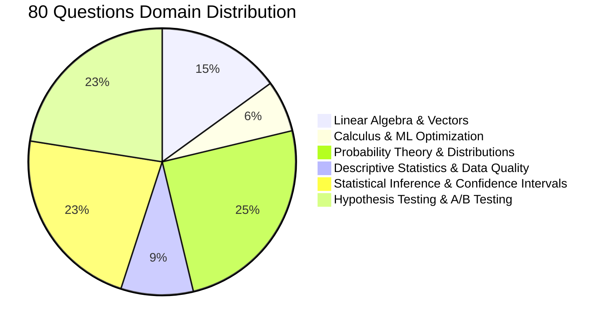

# 🎓 Applied Business Analytics — Applied Statistics Interview Grind
### Track: Data Science & Agentic AI — Module 1 | AlmaBetter

[](https://grow.almabetter.com)
[](https://docs.google.com/document/d/1M5nEE2wK64ewPO-2XwWj4F3Xf9Am-7b9Iho740VOGSA/edit?usp=sharing)
[](https://grow.almabetter.com)

---

## 📌 1. Project Overview & AlmaBetter Curriculum Context

This repository contains the complete research, technical problem solutions, and presentation blueprints for **Module 1: Applied Business Analytics (Applied Statistics Interview Grind)** under the **Data Science & Agentic AI** track at AlmaBetter.

* **Candidate Name:** Jignesh V. ([@jigneshxi](https://github.com/jigneshxi))
* **Program:** MS in Computer Science : Machine Learning & AI Engineering
* **Specialization Track:** **Data Science & Agentic AI**
* **Module:** **Module 1: Applied Business Analytics**
* **Project Name:** **Applied Statistics Interview Grind**
* **Rewards & Weightage:**
  - 🏆 **Reward Points:** **+300 APs**
  - 📈 **Course Progress:** Contributes **+10%** directly toward final grade
  - 🎯 **Passing Threshold:** Minimum **≥ 60%** score required
* **📝 Live Google Docs Submission:** **[Open Final Submission Document on Google Docs](https://docs.google.com/document/d/1M5nEE2wK64ewPO-2XwWj4F3Xf9Am-7b9Iho740VOGSA/edit?usp=sharing)** *(Active document containing all 50 written answers and updated video links)*
* **🎥 Video Explanation Requirement:** 15–20 Minutes (Camera ON, English narration covering 5 chosen topics)

---

## 🗂️ 2. Repository File Structure

```
d:/Jignesh/AB_DS&AAI/ABA/
├── README.md                            # Master repository documentation & curriculum guide (This file)
├── FINAL_SUBMISSION_50_QUESTIONS.md     # Clean Markdown copy of the exact 50 solutions submitted on Google Docs
└── ALL_80_QUESTIONS_ANSWERED.md         # Complete technical question bank answering all 80 questions with math & business context
```

> **Note on Submission Document:** As per project workflow, all 50 written answers and the live video explanation URL are maintained directly in the **[Live Google Docs Submission](https://docs.google.com/document/d/1M5nEE2wK64ewPO-2XwWj4F3Xf9Am-7b9Iho740VOGSA/edit?usp=sharing)**.

---

## 🧭 3. Domain Breakdown of All 80 Questions



### Domain 1: Linear Algebra & Vector Calculus (12 Questions)
*Focus: Vectors, matrices, linear transformations, coordinate spaces, and algebraic foundations of machine learning.*
- **Q1:** What is a vector in mathematics?
- **Q2:** How is a vector different from a scalar?
- **Q3:** What are the different operations that can be performed on vectors?
- **Q4:** How can vectors be multiplied by a scalar?
- **Q5:** What is the magnitude of a vector?
- **Q6:** How can the direction of a vector be determined?
- **Q7:** What is the difference between a square matrix and a rectangular matrix?
- **Q8:** What is a basis in linear algebra?
- **Q9:** What is a linear transformation in linear algebra?
- **Q10:** What is an eigenvector in linear algebra?
- **Q51:** What is the geometric interpretation of the dot product?
- **Q52:** What is the geometric interpretation of the cross-product?

### Domain 2: Calculus & Machine Learning Optimization (5 Questions)
*Focus: Rates of change, gradient descent, partial derivatives, and loss optimization.*
- **Q11:** What is the gradient in machine learning?
- **Q12:** What is backpropagation in machine learning?
- **Q13:** What is the concept of a derivative in calculus?
- **Q14:** How are partial derivatives used in machine learning?
- **Q53:** How are optimization algorithms with calculus used in training deep learning models?

### Domain 3: Probability Theory & Distributions (20 Questions)
*Focus: Random variables, conditional probability, Bayes' theorem, theoretical distributions, joint & marginal probabilities.*
- **Q15:** What is probability theory?
- **Q16:** What are the primary components of probability theory?
- **Q17:** What is conditional probability, and how is it calculated?
- **Q18:** What is Bayes theorem, and how is it used? *(Selected for Video Presentation)*
- **Q19:** What is a random variable, and how is it different from a regular variable?
- **Q20:** What is the law of large numbers, and how does it relate to probability theory?
- **Q21:** What is the central limit theorem, and how is it used? *(Selected for Video Presentation)*
- **Q22:** What is the difference between discrete and continuous probability distributions?
- **Q26:** How do you use the central limit theorem to approximate a discrete probability distribution?
- **Q27:** How do you test the goodness of fit of a discrete probability distribution?
- **Q28:** What is a joint probability distribution?
- **Q29:** How do you calculate the joint probability distribution?
- **Q30:** What is the difference between a joint probability distribution and a marginal probability distribution?
- **Q31:** What is the covariance of a joint probability distribution?
- **Q32:** How do you determine if two random variables are independent based on their joint probability distribution?
- **Q33:** What is the relationship between the correlation coefficient and the covariance of a joint probability distribution?
- **Q56:** What is the left-skewed distribution and the right-skewed distribution?
- **Q58:** What is kurtosis?
- **Q59:** What is the probability of throwing two fair dice when the sum is 5 and 8?
- **Q64:** If there is a 30 percent probability that you will see a supercar in any 20-minute time interval, what is the probability that you see at least one supercar in the period of an hour (60 minutes)?

### Domain 4: Descriptive Statistics & Data Quality (7 Questions)
*Focus: Central tendency, dispersion, percentiles, outlier detection, data cleanup, and degrees of freedom.*
- **Q23:** What are some common measures of central tendency, and how are they calculated?
- **Q24:** What is the purpose of using percentiles and quartiles in data summarization?
- **Q25:** How do you detect and treat outliers in a dataset?
- **Q57:** What is Bessel’s correction?
- **Q60:** What is the difference between Descriptive and Inferential Statistics?
- **Q65:** What is the empirical rule in Statistics?
- **Q80:** What is an inlier?

### Domain 5: Statistical Inference & Confidence Intervals (18 Questions)
*Focus: Sampling strategies, standard error, confidence intervals, margins of error, and correlation analysis.*
- **Q34:** What is sampling in statistics, and why is it important?
- **Q35:** What are the different sampling methods commonly used in statistical inference?
- **Q36:** What is the central limit theorem, and why is it important in statistical inference?
- **Q39:** What is confidence interval estimation?
- **Q41:** What is the difference between correlation and causation? *(Selected for Video Presentation)*
- **Q42:** How is a confidence interval defined in statistics?
- **Q43:** What does the confidence level represent in a confidence interval?
- **Q61:** Jeremy z-score problem (Mean 160, SD 15, z=1.20).
- **Q62:** High correlation between sleep time and productive work: what can be inferred?
- **Q63:** What is the meaning of degrees of freedom (DF) in statistics?
- **Q66:** What is the relationship between sample size and power in hypothesis testing?
- **Q67:** Can you perform hypothesis testing with non-parametric methods?
- **Q68:** What factors affect the width of a confidence interval?
- **Q69:** How does increasing the confidence level affect the width of a confidence interval?
- **Q70:** Can a confidence interval be used to make a definitive statement about a specific individual in the population?
- **Q71:** How does sample size influence the width of a confidence interval?
- **Q72:** What is the relationship between the margin of error and confidence interval?
- **Q73:** Can two confidence intervals with different widths have the same confidence level?
- **Q74:** What is a Sampling Error and how can it be reduced?

### Domain 6: Hypothesis Testing, Experimental Design & A/B Testing (18 Questions)
*Focus: Scientific decision-making, statistical tests (z, t, Chi-square, ANOVA), Type I/II errors, and digital marketing A/B tests.*
- **Q37:** What is the difference between parameter estimation and hypothesis testing?
- **Q38:** What is the p-value in hypothesis testing?
- **Q40:** What are Type I and Type II errors in hypothesis testing? *(Selected for Video Presentation)*
- **Q44:** What is hypothesis testing in statistics?
- **Q45:** What is the purpose of a null hypothesis in hypothesis testing?
- **Q46:** What is the difference between a one-tailed and a two-tailed test?
- **Q47:** What is experiment design, and why is it important?
- **Q48:** What are the key elements to consider when designing an experiment?
- **Q49:** How can sample size determination affect experiment design?
- **Q50:** What are some strategies to mitigate potential sources of bias in experiment design?
- **Q54:** What are observational and experimental data in statistics?
- **Q55:** How are confidence tests and hypothesis tests similar? How are they different?
- **Q75:** What is a Chi-Square test?
- **Q76:** What is a t-test?
- **Q77:** What is the ANOVA test?
- **Q78:** How is hypothesis testing utilised in A/B testing for marketing campaigns? *(Selected for Video Presentation)*
- **Q79:** What is the difference between one-tailed and two-tailed t-tests?

---

## 🎥 4. Detailed Blueprints for the 5 Video Presentation Questions
*(Total Duration: 15–20 Minutes | ~3.5 to 4 Minutes per Question | Camera ON | English)*

```mermaid
gantt
    title Video Presentation Timeline (Total ~18 Minutes)
    dateFormat  m
    axisFormat %M min
    section Introduction
    Self Intro & Agenda : 0, 1m
    section Q1: Bayes' Theorem
    Concept, Math & Applications : 1, 4m
    section Q2: CLT
    Sampling Distributions & Value : 5, 8m
    section Q3: Errors & Power
    Type I vs II Matrix & Business Cost : 9, 12m
    section Q4: Causation vs Correlation
    Confounders & Sleep Study : 13, 16m
    section Q5: A/B Testing
    Statistical Testing & Guardrails : 17, 20m
```



### 1. Question 18: What is Bayes' Theorem, and how is it used?
* **Pacing:** ~3.5 Minutes
* **Core Formula:**
  $$P(A|B) = \frac{P(B|A) \cdot P(A)}{P(B)}$$
* **Key Talking Points:**
  - **Intuition:** Updating initial prior belief $P(A)$ after observing new evidence $B$ to arrive at the posterior belief $P(A|B)$.
  - **Real-World Business Example:** Email Spam Classification (probability an email is spam given it contains the keyword "Cash Prize").
  - **The Medical Screening Paradox:** Why a test that is 99% sensitive still yields false alarms if the underlying disease rate is 0.1% (Base Rate Fallacy).

### 2. Question 21: What is the Central Limit Theorem (CLT), and how is it used?
* **Pacing:** ~3.5 Minutes
* **Key Talking Points:**
  - **Intuition:** Regardless of whether the original population distribution is skewed, uniform, or bimodal, the distribution of the sample means ($\bar{X}$) approaches a normal distribution as the sample size $n$ increases ($n \ge 30$).
  - **Formula Parameters:** Sampling mean $\mu_{\bar{X}} = \mu$; Standard Error $SE = \frac{\sigma}{\sqrt{n}}$.
  - **Business Impact:** Explains why business analysts can construct confidence intervals and run hypothesis tests on customer spending, delivery times, and website traffic without assuming the raw metrics follow a bell curve.

### 3. Question 40: What are Type I and Type II errors in hypothesis testing?
* **Pacing:** ~3.5 Minutes
* **Key Talking Points:**
  - **Null Hypothesis ($H_0$):** Baseline status quo (e.g., customer is honest, system has no bug).
  - **Type I Error ($\alpha$, False Positive):** Rejecting $H_0$ when it is actually true (e.g., blocking a legitimate high-value transaction).
  - **Type II Error ($\beta$, False Negative):** Failing to reject $H_0$ when it is false (e.g., allowing a fraudulent transaction to go through).
  - **Statistical Power ($1 - \beta$):** The probability of correctly detecting an effect when it exists.
  - **Business Trade-off Analysis:** In credit card fraud, a Type II error costs direct capital; in spam filters, a Type I error frustrates users.

### 4. Question 41 & 62: Difference between correlation and causation?
* **Pacing:** ~3.5 Minutes
* **Key Talking Points:**
  - **Correlation:** Statistical measure of how two variables move together ($r \in [-1, 1]$).
  - **Causation:** Verifiable proof that changing variable $X$ directly forces variable $Y$ to change.
  - **The Confounder Problem:** Classic ice cream sales vs shark attacks (both driven by summer temperature).
  - **Deep-Dive on Q62 (Sleep vs Productivity):** Just because hours of sleep correlate with high productivity does not mean forcing employees to sleep 10 hours increases output. A third factor (e.g., mental wellness or low stress) could drive both. Only controlled A/B experiments can confirm causal impact.

### 5. Question 78: How is hypothesis testing utilised in A/B testing for marketing campaigns?
* **Pacing:** ~4.0 Minutes
* **Key Talking Points:**
  - **Step 1 - Hypothesis Formulation:**
    - Null Hypothesis ($H_0$): The new landing page (Variant B) has the same conversion rate as the control (Variant A): $p_B - p_A \le 0$.
    - Alternative Hypothesis ($H_a$): Variant B produces a statistically significant lift: $p_B - p_A > 0$.
  - **Step 2 - Power Analysis & Sample Sizing:** Pre-computing the required sample size based on Minimum Detectable Effect (MDE), significance level $\alpha = 0.05$, and power $1-\beta = 0.80$.
  - **Step 3 - Test Execution & Decision Rule:** Calculating the z-statistic and evaluating the p-value against $\alpha$.
  - **Business Caution:** Beware of "peeking" early, and distinguish statistical significance from business economic viability.

---

## 📋 5. Submission Checklist & Quality Standards

- [x] **50 Questions Selected & Answered:** Full mathematical rigor and business interpretations provided.
- [x] **5 Video Questions Selected:** Structured scripts, visual talking points, and pacing (~18 mins total).
- [x] **Formatted Word Document:** Created native tables, formula callouts, and clean hierarchy in `.docx`.
- [x] **Google Docs Synchronization:** Uploaded and shared via [Google Docs Link](https://docs.google.com/document/d/1M5nEE2wK64ewPO-2XwWj4F3Xf9Am-7b9Iho740VOGSA/edit?usp=sharing).
- [ ] **Video Upload:** Add public YouTube (Unlisted) or Google Drive video link to the final document before submission.
